  

  

 

  

 

<b>👋 Click to say hi</b>

 

Hey, thanks for stopping by! If something here sparks an idea, feel free to reach out on [LinkedIn](https://www.linkedin.com/in/nandini0202/) or by [email](mailto:nandini.23cse@bmu.edu.in).

<b>🔬 What I'm into</b>

 

- 👁️ **Computer vision:** semantic segmentation and urban scene understanding
- 🧠 **GenAI:** retrieval-augmented generation (RAG) and multi-agent workflows
- ⚙️ **Engineering:** Python pipelines, evaluation, and interactive data tools

<b>🏫 Research experience</b>

 

**Computer Vision Research Intern** · CADCS Department, BML Munjal University · *Jun – Sep 2025*

- Worked with 60,000+ Google Street View panoramas across 15 cities
- Prepared datasets and annotations across 29 semantic classes
- Built and evaluated a SegFormer + SAM pipeline for urban scene understanding

<b>🌱 What I'm learning right now</b>

 

Better retrieval, agent orchestration, structured reasoning, and systematic evaluation of AI systems.

<b>🎾 Beyond the code</b>

 

Tennis, experimenting with new ideas, and continuous learning.

<b>🎲 Quick fun facts</b>

 

- ☕ Runs on coffee and curiosity
- 🎾 Tennis is my reset button
- 🧪 I like testing ideas before trusting them

 

  

<b>🔗 Click to open docs for each tool</b>

 

 

 

<b>🔍 See the loop in detail</b>

 

1. **Research** the problem and what already exists
2. **Understand** the data and its constraints
3. **Build** a simple baseline first
4. **Evaluate** results, especially the failures
5. **Improve**, then repeat

 

 

  

